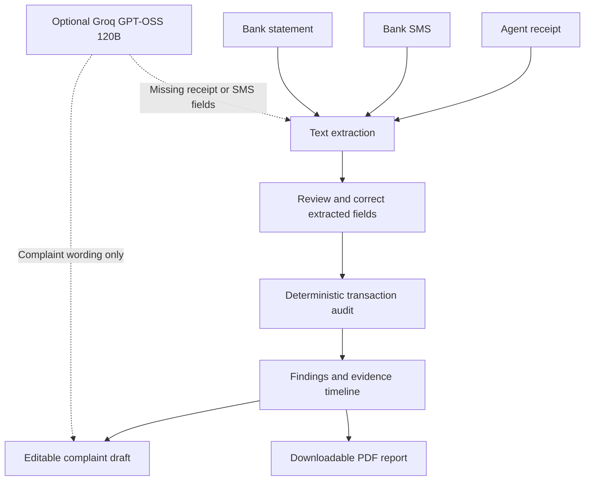

# PaisaProof — Transaction Evidence Lab

> **One transaction. Three records. One evidence-led explanation.**

PaisaProof is a Streamlit demo that helps review a cash-withdrawal transaction by comparing what a customer says they requested and received with three records: an agent receipt, a bank SMS alert, and a bank statement.

It extracts information from submitted records, lets the user review and correct uncertain fields, then applies deterministic rules to identify agreement, discrepancies, possible duplicate debits, reversals, or missing evidence. It can also prepare an editable complaint draft and a downloadable PDF evidence report.

<p>
  
  
  
  
</p>

---

## What it does

- **Accepts three evidence types:** agent receipt, bank SMS, and bank statement.
- **Reads common formats:** PDF, CSV/TXT, and image files where supported by the upload field.
- **Uses OCR for images:** Tesseract reads image-based receipts, SMS screenshots, and statement images.
- **Shows extracted fields for review:** amounts, references, receipt status, and statement entries can be checked or corrected before the audit.
- **Matches transaction records:** uses reference numbers when available and a time-proximity rule for statement debit matching.
- **Applies fixed audit rules:** reports outcomes such as matched, discrepancy, disclosed charge, possible split debit, possible duplicate debit, reversal identified, unmatched, or insufficient evidence.
- **Explains each finding:** shows supporting source quotes, what remains unknown, and a suggested next step.
- **Creates useful outputs:** an editable complaint draft, downloadable complaint text, and a PDF evidence report.
- **Includes sample investigations and evaluation:** runs eight synthetic scenarios with expected outcomes defined in advance.

## How the workflow works



**Important:** Groq does not decide whether a transaction is matched, disputed, reversed, or suspicious. The audit status and findings come from Python rules in `paisaproof/audit.py`.

## AI integration: Groq + GPT-OSS 120B

The configured model is **`openai/gpt-oss-120b`**, called through Groq's OpenAI-compatible chat completions endpoint.

AI assistance is optional. The application still runs its rule-based workflow without a Groq key.

| AI use | When it runs | What it does not do |
|---|---|---|
| Receipt extraction fallback | A receipt was parsed, but its cash amount or reference is missing | Does not invent values; extracted amount/reference must appear in the supplied text |
| SMS extraction fallback | An SMS was parsed, but its debit amount or reference is missing | Does not decide the audit result |
| Complaint wording | For discrepancy, duplicate, and possible-split findings | Does not file or send a complaint |

**Bank-statement rows are parsed by the Python statement parser, not by the Groq fallback.** The final transaction matching and findings are always calculated by the deterministic audit logic.

The sidebar's **AI assistance** panel reports whether a key is configured, which model is selected, and whether the last request succeeded or failed. A configured key does not mean a request has been made: the fallback is only called when its conditions are met. Counters are kept in memory for the current app process and reset when it restarts.

## Screens and outputs

| Section | Purpose |
|---|---|
| Overview | Explains the three-record comparison and starts an audit or sample |
| New audit | Enter the requested/reported amounts, add records, review extracted data, and run the audit |
| Sample investigation | Explore prewritten synthetic examples |
| Evaluation | Run the eight synthetic test scenarios and view rule/extraction metrics |
| Privacy & limits | Review the demo's privacy notes and limitations |

After an audit, results are grouped into:

- **Reconstruction** — a visual comparison of receipt, SMS, and statement amounts plus any available timeline.
- **Findings** — the result, evidence quotes, unknowns, and next steps.
- **Complaint pack** — an editable draft, PDF evidence report, and text download.

## Run locally

### 1. Requirements

- Python 3.11 or later
- Tesseract OCR installed for image uploads
- A Groq API key only if you want optional AI assistance

Text pasted into the app and text-based PDFs can be used without Tesseract. Image OCR requires the Tesseract program as well as the Python packages in `requirements.txt`. Scanned/image-only PDFs may need their text pasted manually if PDF text extraction returns nothing.

### 2. Clone and install

**Windows PowerShell**

```powershell
git clone https://github.com/Shaik-Saniya67/PaisaProof.git
cd PaisaProof
py -m venv .venv
.\.venv\Scripts\Activate.ps1
py -m pip install --upgrade pip
py -m pip install -r requirements.txt
```

**macOS / Linux**

```bash
git clone https://github.com/Shaik-Saniya67/PaisaProof.git
cd PaisaProof
python3 -m venv .venv
source .venv/bin/activate
python -m pip install --upgrade pip
python -m pip install -r requirements.txt
```

### 3. Configure Groq (optional)

Copy `.env.example` to `.env`, then replace the placeholder with your own key:

```env
GROQ_API_KEY=gsk_your_actual_key
GROQ_MODEL=openai/gpt-oss-120b
```

Get a key from the [Groq Console](https://console.groq.com/keys). Keep `.env` private. It is excluded by `.gitignore`; **never commit your real API key**.

If you do not want AI assistance, leave `GROQ_API_KEY` unset. The rest of the application uses the rule-based workflow.

### 4. Start the app

```bash
python -m streamlit run app.py
```

Open the local URL printed by Streamlit (usually [http://localhost:8501](http://localhost:8501)).

## Deploy on Render

This repository includes a `render.yaml` Blueprint and a Dockerfile. The Docker image installs Tesseract and the Python dependencies.

1. Sign in to [Render](https://render.com/).
2. Choose **New → Blueprint** and connect `Shaik-Saniya67/PaisaProof`.
3. Review the service created from `render.yaml`.
4. Add your `GROQ_API_KEY` in the Render service's Environment settings.
5. Keep `GROQ_MODEL` as `openai/gpt-oss-120b` (the Blueprint supplies this default).
6. Deploy and open the service URL.

Do not add the real key to `render.yaml`, GitHub, or the README.

## Tests and evaluation

Run the automated tests:

```bash
python -m pip install pytest
python -m pytest -q
```

The Evaluation page runs **eight synthetic scenarios** covering matching records, a reported cash shortfall, a disclosed charge, related debits, a possible duplicate, a failed transaction with a reversal, missing evidence, and different references.

These examples are authored test cases, not a third-party benchmark or proof of accuracy on real bank documents. The displayed metrics describe performance only on those eight scenarios.

## Privacy, safety, and limitations

- This is a **demo tool**, not an official bank verification service, payment processor, or legal-advice service.
- No database or complaint-submission integration is configured. Uploaded content is handled within the running Streamlit session; the app does not provide durable case storage.
- When a Groq request is triggered, relevant receipt/SMS text or the complaint draft is sent to Groq's API. Review the provider's terms and avoid sending information you are not comfortable sharing with an external service.
- Use synthetic or redacted documents for demonstrations. Mask account numbers, phone numbers, addresses, and other personal information before testing with real records.
- **Cash received is customer-reported.** A receipt, SMS, or statement can show what those sources recorded; it cannot independently prove how much physical cash was handed over.
- OCR and parsing depend on document quality and wording. Always check the review screen and correct uncertain fields.
- Statement rows are matched by the receipt reference when available, or by a debit within ten minutes of the receipt time. Similar timings or incomplete references can cause a false match; verify the records manually.
- The eight synthetic evaluation cases do not establish real-world accuracy. PaisaProof does not automatically accuse an agent or file a complaint.

## Project structure

```text
PaisaProof/
├── app.py                  # Streamlit app and page flow
├── paisaproof/
│   ├── ai.py               # Optional Groq calls and AI activity status
│   ├── audit.py            # Deterministic matching and findings
│   ├── parse.py            # PDF/text/image extraction and parsers
│   ├── report.py           # PDF evidence report generation
│   ├── samples.py          # Eight synthetic evaluation scenarios
│   ├── ui.py               # Styling and reconstruction visuals
│   └── bg.html             # Animated background
├── tests/
│   └── test_cases.py       # Automated tests
├── .env.example            # Safe environment-variable template
├── .gitignore              # Excludes local secrets and generated files
├── Dockerfile              # Render container setup with Tesseract
├── render.yaml             # Render Blueprint configuration
└── requirements.txt        # Python dependencies
```

## Tech stack

**Python · Streamlit · pandas · PyMuPDF · Tesseract OCR · pytesseract · Pillow · ReportLab · Groq API · OpenAI GPT-OSS 120B**

---

*PaisaProof is an evidence-organization and review prototype. Users remain responsible for checking every extracted field and reviewing any complaint draft before use.*
